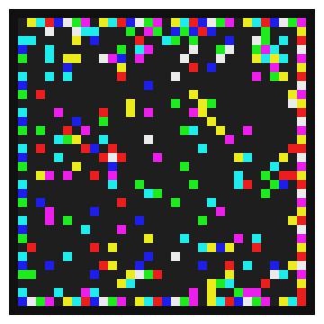
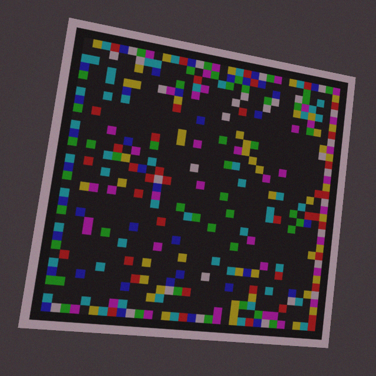
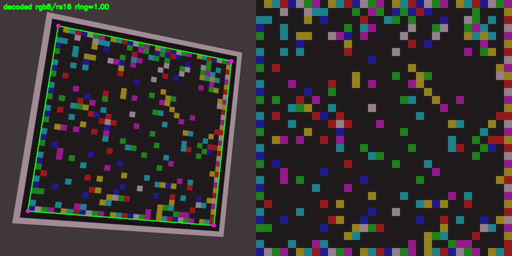

# Optical Modem — screen-to-camera data transfer with YOLO26 frame decoding

A software-defined optical modem: one screen displays frames of coloured cells,
a camera reads them, and the receiver reconstructs the original bytes. This
repository implements the whole stack from the project specification — frame
format, modulation library, forward error correction, adaptive ECC, file
transfer with resume, a synthetic-data pipeline, a **YOLO26** frame detector, a
classical baseline, benchmarks, and a web GUI.

| Transmitted | Captured by a simulated camera | Decoded: corners + rectified grid |
|---|---|---|
|  |  |  |

*Left to right: the frame a screen would show, a capture with perspective,
rotation, gamma, vignetting, blur, noise and JPEG artefacts, and the receiver's
answer — recovered corner quad (ring score 1.00) and the rectified 32×32 grid
that feeds the demodulator.*

---

> **Deploying or continuing this work?** Read [`docs/SUITE_HANDOFF.md`](docs/SUITE_HANDOFF.md)
> first: it is the single document written for whoever (or whatever) picks the
> project up next — deploy on Coolify, the five pipeline stages, the API contract,
> the bugs that were fixed and what is still open.
>
> Deploying behind Traefik or Coolify over HTTPS? `python3 scripts/check_https.py
> --base https://YOUR_DOMAIN --password '…'` prints one verdict per step
> (certificate, http→https redirect, proxy headers, cookie, login, SSE) and
> every failure comes with its fix. Background: `docs/SUITE_HANDOFF.md` §2.2.


## The short version

| | |
|---|---|
| **What YOLO26 does here** | predicts the four corners of the coded grid (one pose instance, 4 keypoints) in a single forward pass |
| **What it replaces** | contour detection, aspect/angle heuristics, threshold tuning — the part that breaks in bad light |
| **What stays classical** | calibration-ring colour fitting, LLR demodulation, Reed-Solomon / LDPC decoding, CRC |
| **Why this split** | neural nets are superb at *where* things are and terrible at *exact* arithmetic; FEC is the opposite |
| **Trained model** | `yolo26n-pose`, fine-tuned on 600 synthetic captures in ~18 min of CPU time; box mAP50-95 = 0.758, pose mAP50-95 = 0.974 |
| **Detector precision** | 100% detection, corners to **5.7%** of the frame side (≈2 cells). Exact sub-cell geometry comes from the ring-scored hypotheses — that is the design, not a workaround |
| **Decode success** | 100% / 100% / 70% / 40% at channel levels 0.0 / 0.3 / 0.6 / 0.9 (`auto` mode, 10 captures each) |
| **Latency** | 240–520 ms/frame end-to-end on 2 CPU cores (YOLO26 inference ≈ 30 ms) |
| **Why n and not s/m** | this workspace has 2 CPU cores and 1.5 GB RAM. `yolo26s/m-pose` train with the same script on a GPU (`--model yolo26s-pose.pt`); see [docs/MODEL.md](docs/MODEL.md) |

Full tables: [docs/BENCHMARKS.md](docs/BENCHMARKS.md).

---

## Try it in 60 seconds

```bash
pip install -r requirements.txt

# what fits in a frame, for every modulation x ECC profile
python -m optical_modem info

# render a frame to a PNG (this is what a screen would show)
python -m optical_modem render --text "hello optical modem" --out frame.png

# full loop: transmit -> simulated camera -> YOLO26 -> demodulate -> FEC
python -m optical_modem sim --level 0.6 --n 10

# decode a real photo of a screen
python -m optical_modem receive capture.jpg

# render a whole file as a frame sequence
python -m optical_modem send --file README.md --out frames/

# benchmark (writes docs/BENCHMARKS.md)
python -m optical_modem bench --n 12

# web GUI  (camera preview + live detection overlay + chat/file transfer)
python -m optical_modem gui --port 8889

# paired capture station: laptop shows codes, phone photographs them
APP_PASSWORD=secret python -m uvicorn optical_modem.capture.app:app --port 8001
```

The GUI is a single page: the transmitter pane renders frames (and can "play"
them like a screen would), the receiver pane uses `getUserMedia` to read a
camera, and a *simulate camera* button runs the entire TX→channel→RX chain
server-side so the demo works without a webcam.

The **capture station** (`optical_modem/capture/`, deployed with the repo's
`docker-compose.yml`) is the other half: a laptop shows a code full-screen and a
phone photographs it, both advancing automatically, so hours of *real* camera
captures accumulate on the server with a label next to each one.
`scripts/captures_to_dataset.py` turns them into a YOLO-pose dataset. See
[docs/CAPTURE_APP.md](docs/CAPTURE_APP.md).

---

## Architecture

```
                       ┌──────────────────────── transmitter ───────────────────────┐
  file / chat text ──► │ Packetizer ─► CRC16 ─► FEC (RS/LDPC) ─► interleave ─► grid │ ──► screen
                       └────────────────────────────────────────────────────────────┘
                                                                        │
                                                              camera / channel
                                                                        │
                       ┌───────────────────────── receiver ──────────────────────────┐
   bytes ◄──────────── │ CRC16 ◄─ FEC decoder ◄─ de-interleave ◄─ LLR demodulator    │
                       │                       ▲                     ▲               │
                       │            calibration ring fit    YOLO26 pose corners      │
                       └────────────────────────────────────────────────────────────┘
```

Receiver stages, each independently testable and benchmarked:

1. **Localise** — `detect/yolo.py` (YOLO26-pose) or `phy/locate.py` (contours).
   YOLO26 gives a *region*: a box that contains the frame plus a first guess at
   the four corners. Contours then supply the candidate *geometries* inside that
   region (a contour may be the dark border ring or the bright plate), and the
   calibration ring decides which one is right.
2. **Align** — `phy/align.py`: coarse-to-fine (zoom, dx, dy) search minimising
   within-cell spread. This is the trick that makes the difference between
   "decodes sometimes" and "decodes reliably": a 0.1-cell offset is enough to
   corrupt a third of the payload. `QuadDecoder` escalates: edge-refined
   candidate quads first, then (when nothing decodes) a coordinate-descent fit
   of all four corners on `locate.align_energy` — the gradient energy *on* cell
   boundaries minus the energy in cell centres, which resolves about a tenth of
   a cell where a palette/ring score saturates at a third. Every pose is
   accepted only if the frame decodes (header RS + CRC), and the remaining
   quarter turns are retried on the sampled symbols for free.
3. **Calibrate** — `phy/demod.py`: robust affine colour fit on the known
   calibration ring, in two variants (raw, and illumination-normalised by
   division with a blurred copy). The ring score ranks them, but both are tried
   against the header: a shadow over the payload is invisible to a ring that
   sits on the frame border, and the header is the only honest oracle.
4. **Demodulate** — Gaussian likelihood over palette points → symbol, per-bit
   LLR, confidence.
5. **FEC** — low-confidence bytes are handed to Reed-Solomon as *erasures*
   (soft decision), then CRC16 verifies the frame.

---

## Frame structure

```
┌─────────────── white quiet zone ───────────────┐
│ ▓ dark border ring (1 cell) ▓                  │   ← detection target for both
│   ┌────── coded grid (32x32 cells) ──────┐     │     YOLO26 and contours
│   │ calibration ring (known symbols)     │     │   ← colour calibration + orientation
│   │ header: 11 B + RS(16)                │     │   ← modulation, ECC, seq, length, mask
│   │ payload: data + CRC16 + FEC          │     │   ← user bytes
│   └──────────────────────────────────────┘     │
└────────────────────────────────────────────────┘
```

* 11-byte self-describing header (magic, version, modulation id, ECC id, frame
  type, 16-bit sequence, 16-bit length, whitening mask) protected at a fixed
  rate, so a receiver can read it before it knows the sender's settings.
* **Payload whitening.** Every payload symbol is XORed with a mask seeded from
  the header, so a short payload no longer paints a slab of identical dark tiles
  into the zero-padded tail. On an 80-cell frame carrying 2 bytes the modal
  symbol share drops from 0.90 to 0.03 and the longest run of identical symbols
  from 79 cells to 3 — the frame looks like data everywhere, and local receiver
  statistics (background, gain) are no longer biased by a flat slab. Three mask
  families are available (PRNG default, alternating, index ramp) plus `none` for
  A-B testing; see [docs/PROTOCOL.md §2.1](docs/PROTOCOL.md).
* Capacity (default 32x32 grid): `gray2` 1 bit/cell → 68 B/frame,
  `gray4` 2 bit/cell → 177 B, `rgb8` 3 bit/cell → 258 B, `rgb8x2` 4 bit/cell →
  356 B (after CRC and FEC at RS(16)).
* Every frame carries a CRC16; multi-frame messages carry a whole-message CRC so
  the receiver can verify reassembly and retransmit only missing sequence
  numbers.
* **Optional finder pattern.** `layout.finder` picks one shape from a catalogue
  (`ring`, `dice`, `bullseye`, `checker`, `diamond`, `cross`, `x`, `bracket`,
  `triangle`, `solid`, or `none`) and `layout.finder_span` places it in the inner
  corners, three corners, the centre or the edge mid-points. Its symbols are
  **removed from the header/payload lists before either is filled** and the codec
  asserts the four regions are disjoint and exhaustive, so a finder can never
  overwrite data — it costs capacity (~10 % for the 5×5 shapes, ~6 % for 4×4) and
  the UI shows exactly how much. See [docs/PROTOCOL.md §1.1](docs/PROTOCOL.md).

Full details: [docs/PROTOCOL.md](docs/PROTOCOL.md).

---

## YOLO26 frame detector

* **Task**: pose estimation — one class (`optical_frame`), four keypoints =
  the coded-grid corners in the transmitter's own orientation
  (TL, TR, BR, BL). `flip_idx: [1,0,3,2]` keeps horizontal-flip augmentation
  semantically correct.
* **Data**: `optical_modem/data/synth.py` renders random frames (random
  modulation, ECC, grid size, cell size, payload) and pushes them through the
  camera-channel simulator (perspective, rotation, scale, gamma, white balance,
  vignetting, motion/defocus blur, sensor noise, JPEG, specular highlight,
  shadow). Labels are generated from the rendering geometry, so they are exact.
* **Model**: `yolo26n-pose.pt` fine-tuned; the pose head is re-initialised for
  4 keypoints, backbone transferred.
* **Inference**: NMS-free end-to-end head (`nms=True` in the YOLO26 sense), 448 px
  input, ~40–60 ms/image on 2 CPU cores.
* **Output contract**: the detector returns `Quad` objects — identical to what
  the classical detector returns — so the demodulator/FEC path is shared and the
  benchmark is a fair comparison of *localisation only*.
* **What the numbers say** (details in [docs/MODEL.md](docs/MODEL.md#4-results)):
  a 2.5 M-parameter model at 448 px finds 100% of frames but places corners to
  ≈2 cells. A 32×32 grid needs ~0.1 cell accuracy, which no detector of this size
  delivers directly — so the pipeline uses the prediction as a region seed and
  resolves the exact lattice with the calibration ring. `auto` mode (YOLO seed +
  unrestricted search, best hypothesis wins) is the most accurate configuration
  at every impairment level and never worse than either half alone.

Swap in a bigger model without touching any other code:

```bash
python -m optical_modem.data.train_yolo \
    --model yolo26m-pose.pt --epochs 120 --imgsz 640 --batch 32 --device 0
python -m optical_modem sim --mode yolo --weights models/yolo26_optical/weights/best.pt
```

Details, including the exact training recipe and expected throughput for
`yolo26s/m`: [docs/MODEL.md](docs/MODEL.md).

---

## Project layout

```
optical_modem/
  config.py            modulation palettes, ECC profiles, geometry, capacity
  protocol/            packet.py (header, CRC, chunking, resume)
                       ecc.py (RS + LDPC + erasures)
                       frames.py (bit packing, interleaving, block sizing)
  phy/                 render.py, channel.py, locate.py, align.py, demod.py,
                       classical.py
  detect/yolo.py       YOLO26 detector adapter
  protocol/finder.py   finder-shape catalogue, spans, placement, scoring
  receiver.py          HybridReceiver (yolo / classical / auto)
  bench.py             benchmarks + markdown report
  data/                synth.py (dataset), train_yolo.py (training)
  suite/               the whole deployed app: FastAPI pages + /api/suite/*,
                       jobs.py (subprocess runner), registry.py (disk artefacts),
                       db.py (projects/datasets/runs/models/jobs/transfers in
                       Postgres or SQLite), bus.py (Redis events + locks, with an
                       in-process fallback), s2c.py (the modem app), static/**
  capture/             paired capture station (PWA: display + camera roles)
  cli.py               command line entry point
tests/                 unit tests (protocol, phy, receiver, detector, capture)
scripts/               bench pipeline, dataset build, capture->dataset, assets
docs/                  PROTOCOL.md, MODEL.md, BENCHMARKS.md, CAPTURE_APP.md
Dockerfile             the suite image (torch CPU, one uvicorn worker)
docker-compose.yml     Coolify deployment: suite + Postgres 16 + Redis 7,
                       volumes suite-data / suite-db / suite-redis
```

---

## Testing

```bash
python -m pytest -q          # 207 tests
```

The suite covers Reed-Solomon/LDPC repair (including erasures and a guard
against degenerate LDPC matrices), header/CRC handling, frame round-trips for
every modulation x ECC combination, interleaver invertibility, renderer
geometry, ground-truth-quad decoding, shadow-robust calibration, multi-frame
reassembly with dropped frames (resume), and the YOLO26 detector (corner error,
keypoint ordering, end-to-end decode). The state layer is covered too:
`tests/test_finder.py` (the no-overwrite guarantee, capacity accounting, spans,
round-trips for every shape), `tests/test_store.py` (projects in development vs
finished, artefact upserts, detach-on-delete, idempotent disk import — on SQLite,
the same schema Postgres gets) and `tests/test_bus.py` (pub/sub exactly once,
cross-process locks, heartbeats, capped event ring — against a real Redis socket
via `fakeredis`).

---

## Guided UI

Nobody should have to read a README to get this running. The app ships with a
guided setup that knows where *your* box is:

* **`/wizard`** — six stages (environment → project → dataset → train → verify →
  send), one at a time, each with an illustration, a plain-language "why", a
  checklist that ticks itself, and a button that runs the step with defaults sized
  to the machine. It re-reads `GET /api/suite/progress` on every job event, so a
  step ticks off when the work *finishes*, not when you click.
* **`/` dashboard** — the pipeline drawn as a state-aware diagram (screen →
  optics → camera → detector → FEC → file), a completion ring, and a single "do
  this next" card.
* **Inline visuals** — finder patterns as thumbnails rendered from the same mask
  the transmitter uses, colour palettes as swatches with the bytes/frame they
  buy, training curves from `results.csv`, decode-rate bars per channel level, and
  empty states that offer the one action that fills them.
* **No chart library.** Everything is a small SVG built from data
  (`static/js/viz.js`), so the PWA works offline and the visuals survive a
  sandboxed preview with no network.

`node scripts/ui_preview.mjs --base http://127.0.0.1:8200 --password demo
--out devdata/ui_preview.html` renders all of it against a live server into one
static file — the fastest way to review the UI without a browser.

---

## State & deployment

`docker-compose.yml` runs three services, not one:

| service | role |
|---|---|
| `suite` | the app: pages, S2C, job runner, dataset builder, trainer |
| `db` | **Postgres 16** — projects (development / finished / archived), datasets, runs, models, jobs, transfers, events |
| `redis` | job events fan-out (SSE), `SET NX EX` locks ("one training job at a time"), worker heartbeats |

The database stores *metadata only*: photos, weights and rendered frames stay on
the `suite-data` volume, so backups stay small and the container stays stateless.
Both layers are optional — without `DATABASE_URL` the app uses SQLite at
`$DATA_DIR/suite.db`, without `REDIS_URL` an in-process bus — and neither can
fail a training run or a transfer ([`suite/db.py`](optical_modem/suite/db.py),
[`suite/bus.py`](optical_modem/suite/bus.py)).

The **Projects page** (`/projects`) is the UI for it: create a project, flip it to
`finished`, see which datasets/runs it owns and watch the live event feed. Every
artefact endpoint takes an optional `"project": "<slug>"` field, and the Dataset
and Train pages remember your choice. Boot reconciles the database with whatever
is already on the volume, so an older `/data` appears populated instead of empty.

---

## Limitations & next steps

* **Localisation is the current bottleneck, not demodulation.** With a perfect
  quad every one of the 13 modulations round-trips exactly (0 symbol errors,
  0 corrections, CRC + FEC pass). Through the simulated camera the limiting
  step is getting the four corners to better than ~0.2 of a cell (and, more
  often, getting the *quarter turn* right: the ring is rotation invariant, so
  `QuadDecoder` retries the remaining three rotations on the sampled symbol
  grid — four header decodes cost well under a millisecond and turned the
  common "header unreadable" failure into a rotation fix): the
  calibration ring cannot resolve that (a 30% colour mix still rounds to the
  right palette entry). `locate.refine_quad` fits the straight edges of the
  border ring, `locate.refine_quad_energy` then moves the four corners on the
  cell-lattice gradient energy (it resolves ~0.1 cell; the ring saturates at
  ~0.35), and `QuadDecoder` accepts a pose only if the frame decodes (header RS
  + payload CRC). Measured single-shot success at 1280x720 `rgb8`/RS(16) with
  whitening on: 100% at channel levels 0.0-0.2 and ~65% at 0.5 in the
  [benchmark run](docs/BENCHMARKS.md) (n=6); an independent 12-capture sweep at
  0.2 gave 7/12, so single-digit differences between runs are noise. Patterned
  modes need >= 16 px per cell and are stricter than colour modes.
* **A clipped specular highlight is the dominant residual failure.** The channel
  model's highlight is an additive blob of up to +150; it pushes 20-25% of the
  cells to 255, and clipped colour is information the demodulator cannot
  recover (the frame is consistent with *any* symbol brighter than the clip
  point). Every frame that failed in the 12-capture sweep at level 0.2 had
  drawn a highlight. The receiver now tries both photometric variants (raw and
  illumination-normalised) per pose and lets the header choose — the ring sits
  on the unshaded border and was voting for the variant that is wrong for the
  payload, which is what made shadowed frames score 1.00 on the ring and fail
  on the header. What is left needs a sensor-side fix (shorter exposure, HDR) or
  local clipping detection to hand out erasures, not a stronger code.
* **Rejected: block-wise moment matching** (`local_tone_normalize`). Matching
  each block's colour spread and centre to the frame's is well posed in theory
  — whitening makes symbol usage uniform, so every block should look like the
  palette through its own tone curve — but on synthetic frames it lost to the
  plain local-mean division (0.6-17% vs 0-5% cell error on a half-frame gain
  ramp) because the palette has no dark end: an arbitrary local offset is not
  identifiable. Recorded here so it is not retried; the function was removed
  rather than left unused.
* The bundled YOLO26 weights were trained on the **v0.2 renderer** (flat tiles,
  no sub-cell patterns, no display geometry). They still localise frames but
  decode rates through them are poor; retraining on v0.3 frames is pending.
* Decode latency is 0.8-2 s per frame on a laptop CPU (the pose search and the
  multiple candidate quads dominate); the fast path (ring pose only) is ~0.3 s.
* The detector is trained on **synthetic** captures. Real phone cameras add
  rolling shutter, auto-exposure pumping and reflections that the simulator only
  approximates — the honest next step is to capture a few hundred real frames
  and fine-tune (the same script works, just point `--data` at a real dataset).
* Synchronous mode assumes the camera sees at least one full frame per exposure;
  every frame is independently decodable, so asynchronous capture works too, but
  throughput drops when frames are missed.
* Phase/flicker modulation (spec §5) is stubbed by the composite profile
  (`rgb8x2`); true temporal modulation needs camera frame-sync.
* `yolo26s/m` fine-tuning is a GPU job; the training script and dataset
  generator are model-size agnostic.
