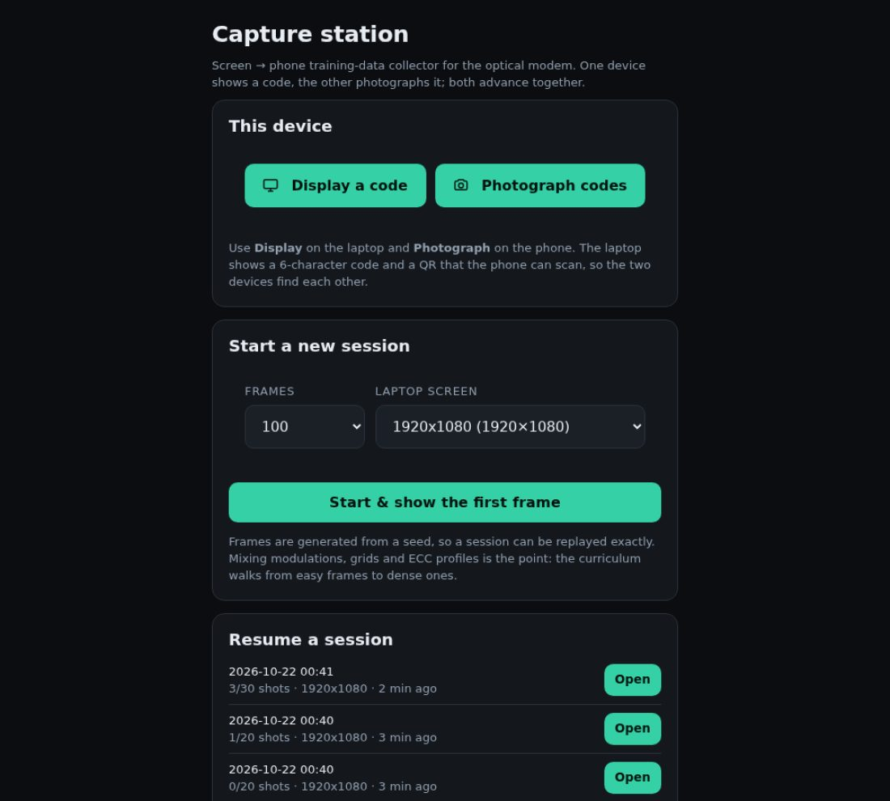
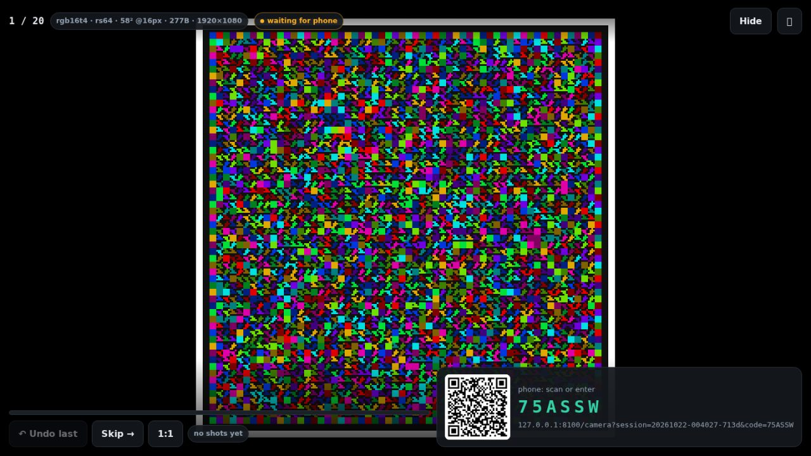
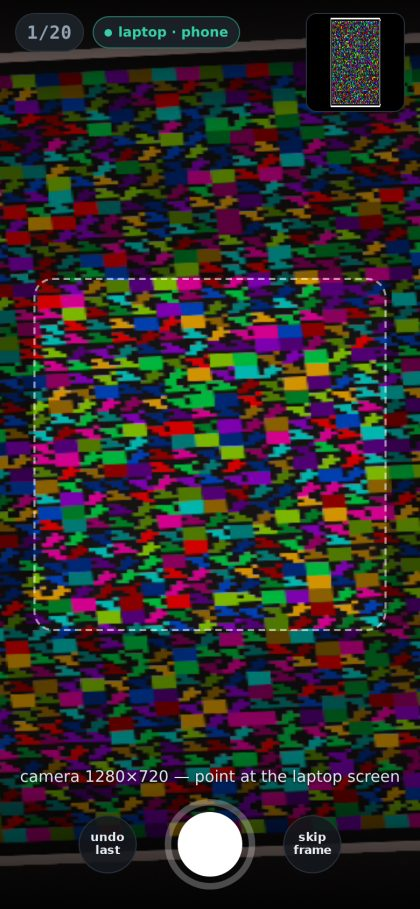
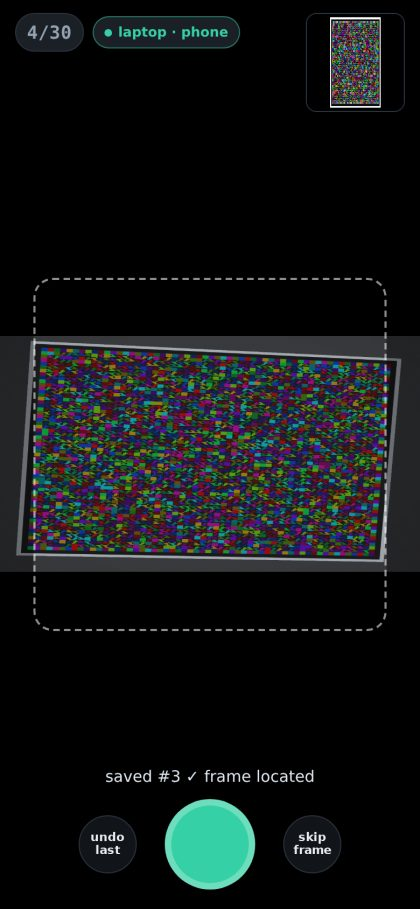

# Capture station — a paired screen→phone training-data collector

A small self-hosted PWA for the job the simulator cannot do for you: photograph
real codes off a real screen with a real phone camera, at scale, and end up with
a labelled detector dataset.

Two devices, one session:

```
laptop /display          phone /camera
┌────────────────┐      ┌────────────────┐
│ full-bleed     │      │ live rear      │
│ frame + code   │◄────►│ camera +       │   both advance automatically
│ + pairing QR   │  SSE │ shutter        │   after every accepted shot
└────────────────┘      └────────────────┘
        │                        │
        └────────────┬───────────┘
                     ▼
        FastAPI (single worker) + /data volume
        sessions/<id>/frames/NNNN.png        ideal frame (PNG, cached)
        sessions/<id>/shots/NNNN_A.jpg       the photo
        sessions/<id>/shots/NNNN_A.json      sidecar: spec + label
```

Everything is generated from `(seed, index)`, so a session is a *plan*, not
state: restart the container and the frames come back identical, and every
photo is unambiguously tied to the frame that was on the screen when it was
taken.

| | |
|---|---|
|  |  |
| sign in, pick a role, start a session | the laptop shows one frame full-bleed + the pairing code/QR |
|  |  |
| the phone's live view, target thumbnail, shutter | frame located, saved, both devices advanced |

*(Screenshots are from the headless two-client run described in §6, with a
simulated capture fed to Chromium's fake camera.)*

---

## 1. Deploy on Coolify (Ubuntu VPS, Docker Compose)

1. Push this repository, then in Coolify: **+ New → Docker Compose** and point
   it at the repo (it picks up `docker-compose.yml`).
2. Set the environment variables:

   | variable | required | meaning |
   |---|---|---|
   | `APP_PASSWORD` | **yes** | the station password, used by both devices |
   | `APP_SECRET` | recommended | HMAC key for session cookies (`openssl rand -hex 32`); if empty one is generated and persisted to `/data/secret.key` |
   | `DATA_DIR` | pre-set `/data` | where sessions live (the named volume) |
   | `COOKIE_SECURE` | pre-set `1` | set `0` **only** for plain-http testing |
   | `AUTOLABEL` | pre-set `1` | locate the frame in every upload (~0.5–1.5 s of CPU) |
   | `MAX_UPLOAD_MB` | pre-set `24` | reject bigger photos early |
   | `CAPTURE_PORT` | `8000` | host port (Coolify's proxy can also reach the container directly) |

3. Set a **domain** (Coolify terminates TLS) and deploy. The image is
   `python:3.12-slim` + NumPy/OpenCV/FastAPI — about 1 GB, no torch.
4. Open `https://<domain>/` on the laptop, sign in, start a session.

Requirements/limits that matter:

* **HTTPS is required** for the phone camera. `getUserMedia` (and PWA install,
  wake lock, service worker) are only available in a secure context. Coolify
  gives you that; plain `http://<ip>:8000` will fall back to the phone's own
  camera app via `<input capture>`, which also works but is slower.
* **One uvicorn worker.** Session state is in memory and the live updates go
  through in-process queues; `--workers 2` would serve two different worlds.
  The compose file hard-codes `--workers 1`.
* Disk: a 12 MP JPEG is ~1.5–3 MB and the cached frame PNG is ~0.5–2 MB per
  frame of the plan (only the frames actually shown are rendered). 100 GB is
  ~20 000 photos.
* CPU: the photo decode + auto-label + SSE fan-out is the only work. Two cores
  of the VPS are plenty for one phone; the container is capped at 2 CPU / 2 GB.

### Local smoke test

```bash
APP_PASSWORD=secret docker compose up --build
# laptop: http://localhost:8000/  -> Display a code
# phone:  http://<lan-ip>:8000/camera?code=XXXXXX      (COOKIE_SECURE=0)
```

---

## 2. Running a capture session

**Laptop — `/display`**

* Start a session (frames, screen resolution) from the landing page, or open an
  existing one. The page shows the current frame full-bleed, `1:1` toggles
  pixel-exact display (useful to check the screen isn't scaling the code),
  `⛶` goes fullscreen, `Hide` hides the overlay so nothing but the code is
  photographed.
* The pairing panel carries the **6-character code** and a **QR** of the phone
  URL. It collapses to a chip by itself once the phone starts shooting (tap it
  to bring it back), and the HUD dims out of the way.
* `↶ Undo last` / `Skip →` are the same actions as on the phone.

**Phone — `/camera`**

* Scan the QR (it carries `?session=…&code=…`, so it pairs automatically) or go
  to the domain and type the code. The camera opens immediately, rear camera,
  no audio.
* Frame the laptop screen inside the dashed guide (the guide is a hint: the
  labeller finds the frame anywhere in the photo) and tap the shutter. The photo
  is normalised to ≤2560 px on the long edge, EXIF-rotated, and uploaded as
  JPEG. Both devices advance to the next frame as soon as the server accepts it.
* `undo last` re-shoots the previous frame, `skip frame` moves on without a
  photo (recorded as skipped, never confused with a shot).

Good captures: fill most of the phone frame, avoid a second screen or the
laptop's own reflection of the code, keep the phone roughly parallel (up to
~28° tilt is fine), and let autofocus settle. A shot with a specular highlight
across the code still trains the detector — it is simply not labelled
confidently (see below).

**Both** pages hold a wake lock and reconnect on their own (the live feed is
Server-Sent Events carrying whole state snapshots, so a phone that drops off in
a lift comes back consistent).

---

## 3. What the server stores

```
/data/sessions/20261022-003919-29b2/session.json      plan + cursor + shot index
                  .../frames/0000.png                  rendered ideal frame
                  .../shots/0000_1.jpg                 upload
                  .../shots/0000_1.json                sidecar
```

The sidecar is the interesting file:

```jsonc
{
  "index": 0, "attempt": 1, "file": "shots/0000_1.jpg",
  "device": "Android 14; Pixel 8", "via": "getusermedia",
  "width": 2560, "height": 1440, "bytes": 812344,
  "spec": {                       // full description of the frame on screen
    "modulation": "rgb16t4", "ecc": "rs64", "resolution": "1920x1080",
    "cells": 58, "cell_px": 16, "payload_bytes": 277,
    "geometry": { "x0": …, "y0": …, "grid": [x0, y0, x1, y1], "code_px": 928, … },
    "capacity": { … }
  },
  "label": {                      // in *photo* pixels
    "found": true, "verified": true, "score": 1.0,
    "quad": [[x, y], [x, y], [x, y], [x, y]],   // grid TL, TR, BR, BL
    "energy": 18.4, "candidates": 4, "source": "eq",
    "image_size": [2560, 1440]
  }
}
```

`label.score` is the calibration-ring fit: it is the fraction of the frame's own
1-cell border (whose colours are known) that the proposed quad predicts
correctly. It is cheap and sharp — the ring is only one cell wide, so a quad
that is a whole cell out scores near zero — which is why the labeller can say
"this really is the frame" without decoding the payload at all.

`verified` (score ≥ 0.85) is the flag to filter on. On simulated handheld
captures at 1080p–12 MP, ~70–80 % of shots come back verified with a median
corner error around 0.1–0.25 cell; the rest are still on disk and still useful —
they just want a detector, or a human, to place the box.

Auto-label cost: ~0.5–1.5 s per upload on one core for a 12 MP photo (it runs
off the event loop, so the SSE stream keeps flowing). Set `AUTOLABEL=0` if you
would rather label the whole batch later.

---

## 4. From photos to a YOLO-pose dataset

```bash
python scripts/captures_to_dataset.py --data-dir /srv/capture-data \
    --out datasets/captures --verified-only --val-frac 0.15
```

It writes the same layout `optical_modem/data/synth.py` writes, so `train.py`
does not care where the data came from:

```
datasets/captures/images/{train,val}/*.jpg
datasets/captures/labels/{train,val}/*.txt    cls cx cy w h  +  4 x (x y vis)
datasets/captures/data.yaml                  kpt_shape: [4, 3], flip_idx: [1, 0, 3, 2]
datasets/captures/manifest_captures.json
```

Keypoints are the frame's **grid** corners in transmitter orientation
(0 = TL, 1 = TR, 2 = BR, 3 = BL) — identical to the synthetic labels, so real
and simulated data can be mixed in one dataset. The train/val split is by
*session*, so one screen/scene/lighting setup never straddles both.

`--link` symlinks instead of copying, `--min-score` filters harder than
`--verified-only`, `--session <substring>` exports a single session.

---

## 5. HTTP API (for scripting)

All `/api/*` routes need the login cookie (`POST /api/login {"password": …}`).

| route | what it does |
|---|---|
| `GET /api/capabilities` | modulations, display sizes, defaults, whether a password is set |
| `POST /api/sessions` | `{count, resolution, seed?, label?}` → new session snapshot |
| `GET /api/sessions` | list sessions with progress |
| `GET /api/sessions/lookup?code=` | pairing code → session id |
| `POST /api/sessions/{id}/join` | `{role: "camera"\|"display", code}` — the phone must know the code |
| `GET /api/sessions/{id}` | full snapshot (index, counts, roles, current frame description) |
| `GET /api/sessions/{id}/frame.png?index=` | the ideal frame, immutable and long-cached |
| `POST /api/sessions/{id}/shots` | multipart `file` + `index` (+ `device`, `via`, `width`, `height`) |
| `POST /api/sessions/{id}/{reject,skip,seek}` | cursor control (`seek` takes `{index}`) |
| `GET /api/sessions/{id}/events` | SSE: `state`/`shot`/`reject`/`skip`/`seek`, one snapshot per event, 15 s pings |
| `GET /api/sessions/{id}/export` | plan + every shot sidecar (no images) |
| `GET /api/qr.svg?data=` | QR for the pairing URL (offline, `segno`) |

Uploads are validated (JPEG magic, decodable, ≥32 px, ≤`MAX_UPLOAD_MB`) and are
refused with **409** if the `index` is no longer the one on screen — a double
tap or a slow link cannot file a photo against the wrong frame.

---

## 6. Tests

```bash
pytest tests/test_capture.py -q
```

Covers plan determinism, storage/reload, auto-labelling accuracy on simulated
handheld captures (and that it never *claims* confidence it does not have),
upload validation, the 409 resync, pairing codes, PWA assets, the QR endpoint,
and the photo→YOLO-pose conversion. The two-client flow was additionally
exercised end to end in headless Chromium with a fake camera, which is how the
devices' auto-advance and the SSE path were checked.
